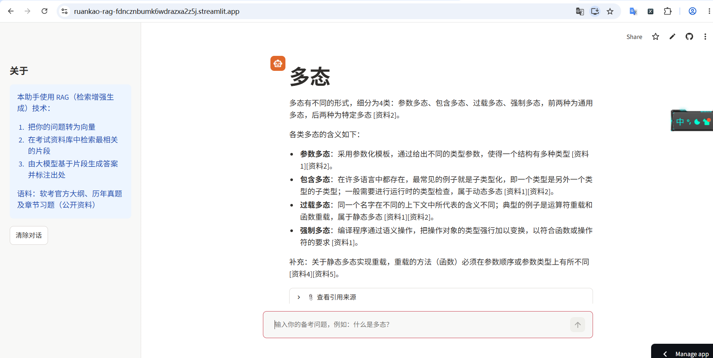
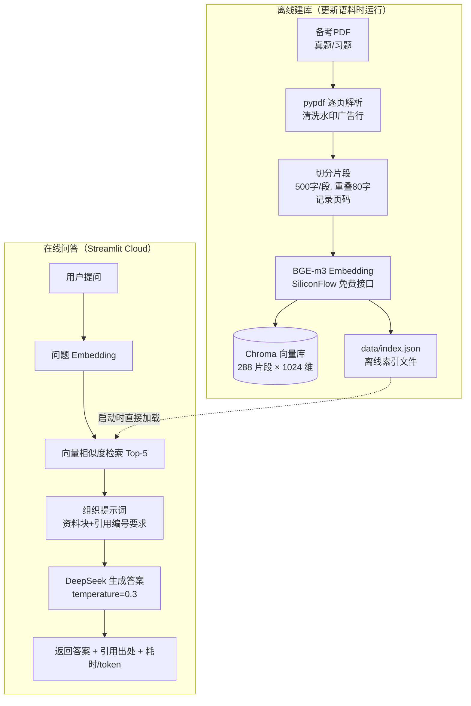

# 软件设计师智能问答助手（RAG）

基于检索增强生成（RAG）的软考中级「软件设计师」备考问答系统：针对考试资料库提问，生成**带引用出处**的答案；资料没有的内容会如实告知，绝不编造。

**🌐 在线Demo**：https://ruankao-rag-fdncznbumk6wdrazxa2z5j.streamlit.app/

> Demo 托管在 Streamlit Cloud 免费档：长时间未访问会休眠，首次打开需点击唤醒并等待约 1~2 分钟，之后使用流畅。国内访问 `.streamlit.app` 偶发不稳定，若打不开请换个网络环境重试。

| 线上真实效果 | 回答与引用溯源 |
|---|---|
|  | 每个论断标注 [资料N]，可展开查看出处文档与页码 |

## 功能特性

- 💬 自然语言提问，流式展示备考知识
- 📎 **引用溯源**：答案中的关键论断均标注来源（文档名 + 页码），可展开查看原文片段
- 🙅 **防幻觉**：语料中没有的内容明确回答"参考资料未涉及"，而非编造
- 📊 每次问答显示实测耗时与 token 用量（成本透明）

## 系统架构



**冷启动优化**：云端不现场解析PDF（曾导致冷启动约3分钟），改为本地预计算 `data/index.json`（片段+向量，3MB，随仓库分发），启动时直接加载内存向量库，秒级就绪。

## 技术选型与理由

| 环节 | 选型 | 理由 |
|---|---|---|
| 大模型 | DeepSeek（`deepseek-chat`） | 中文能力强、价格约为国际同类产品的 1/10 以下；低温度(0.3)保证备考答案的确定性 |
| Embedding | BAAI/bge-m3（SiliconFlow 托管） | 中文效果第一梯队开源模型；SiliconFlow 提供免费额度，零成本 |
| 向量库 | Chroma | pip 一键安装、内存/持久化双模式，288 规模下检索毫秒级，且是教学友好的主流选型 |
| 前端/后端 | Streamlit | 一个文件同时完成界面与服务端逻辑，免写前后端对接；Streamlit Cloud 原生托管，零配置部署 |
| 文档解析 | pypdf | 纯 pip 安装无系统依赖，对文字版中文 PDF 提取质量足够 |
| 切分策略 | 按行累积 ~500字、重叠80字 | 平衡语义完整性与检索精度；重叠防止答案正好被切断；行级清洗可精确删除水印 |

未采用但评估过的方案：LangChain/LlamaIndex（对初学者黑盒过多，不利于理解原理）、FAISS（需手动管理元数据）、Gradio+Render/HF（部署平台国内不可达，见下）。

## 实测数据（2026-11，真实测量非估算）

**语料规模**：9 份 PDF（2020–2023 真题 5 份 + 章节习题 4 份）→ 288 个片段，平均 479 字/片段

**延迟**：

| 指标 | 数值 | 说明 |
|---|---|---|
| 建库向量化 | 3.1 秒 | 288 片段 × bge-m3，本地调用 SiliconFlow |
| 单次问答-检索 | 2.4~3.6 秒 | 主要耗时在"问题转向量"的 API 往返；向量检索本身 <100ms |
| 单次问答-生成 | 1.0~2.2 秒 | DeepSeek 非流式输出 20~270 token |
| 端到端 | 约 4~6 秒/问 | 本地实测 |
| 云端冷启动 | 约 1~2 分钟 | 免费档休眠唤醒 + 容器重建（含依赖缓存） |

**成本**（按 DeepSeek-V3.2 2025年12月定价：输入 $0.28/百万token〔缓存命中 $0.028〕，输出 $0.42/百万token，[官方价格页](https://api-docs.deepseek.com/quick_start/pricing/)）：

- 单次问答 token：输入约 1660（5 个资料片段 + 提示词模板），输出 20~270
- **单次问答成本 ≈ $0.0005 ≈ ¥0.004**；充值 10 元约可问答 **2500+ 次**
- Embedding：SiliconFlow 免费额度，成本为 0
- 托管：Streamlit Cloud 免费档，$0

## 快速开始（本地运行）

```bash
git clone https://github.com/chuxin66666/ruankao-rag.git
cd ruankao-rag
python -m venv .venv
.venv/Scripts/pip install -r requirements.txt

# 1. 复制 .env.example 为 .env，填入 SILICONFLOW_API_KEY 和 DEEPSEEK_API_KEY
# 2. 启动界面
.venv/Scripts/python -m streamlit run app.py
```

其他入口：

```bash
# 命令行问答（调试检索/生成效果）
.venv/Scripts/python src/qa.py "什么是多态？"

# 重新建库（增删语料后）
.venv/Scripts/python src/build_index.py
.venv/Scripts/python tools/export_index.py   # 同步导出云端用的离线索引
```

## 项目结构

```
ruankao-rag/
├── app.py                  # Streamlit 应用（界面+启动预加载）
├── src/
│   ├── config.py           # 全部可调参数（切分/检索/模型）集中管理
│   ├── build_index.py      # 建库管道：解析→清洗→切分→向量化→入库
│   └── qa.py               # 问答核心：检索→提示词→DeepSeek→引用输出
├── tools/
│   ├── download_data.py    # 语料下载（一次性）
│   └── export_index.py     # 离线索引导出（云端冷启动优化）
├── data/
│   ├── raw/                # 语料PDF
│   └── index.json          # 预计算向量索引（云端秒载）
└── docs/images/            # 截图
```

## 数据来源与版权

语料为公开流传的软考备考资料（历年真题及章节习题，采集自 [Gitee 公开备考仓库](https://gitee.com/stepwen2/software_designer)），**仅供学习交流使用**；如涉及版权问题请联系删除。未使用任何版教材扫描件（曾获取的官方大纲PDF为扫描图片版，因无法提取文字且规避版权风险而未入库）。

## 已知局限（诚实清单）

1. **语料覆盖度是效果上限**：语料为真题/习题而非系统教材，知识性总结问题（如"瀑布模型的优缺点"）可能检索不到，此时助手会如实说"参考资料未涉及"——这是设计使然（诚实优于编造），根治需扩充语料
2. 未做检索重排序（rerank）与混合检索（关键词+向量），个别问题 Top-5 片段相关性一般
3. 免费档 Demo 会休眠，首次访问需唤醒等待
4. 对话历史存于浏览器会话，刷新即清空（无用户体系）

## 后续优化方向

- [ ] 混合检索：BM25 关键词 + 向量双路召回，提升术语型问题命中率
- [ ] 接入 bge-reranker 对 Top-K 重排序
- [ ] 语料扩充：整理官方大纲要点笔记入库（人工整理的原创笔记，无版权风险）
- [ ] 回答流式输出（streaming）与"有用/无用"反馈按钮
- [ ] 多轮对话（带着上文追问）

## 开发过程中的关键决策记录

- **部署平台三易其稿**：Hugging Face Spaces 国内不可达 → Render 不可达 → Zeabur 停止注册 → 最终 Streamlit Cloud（GitHub 直连、Secrets 管理密钥、免费档够用）。国内访问 streamlit.app 偶发不稳定是免费方案的固有代价，已如实记录
- **云端冷启动从 3 分钟优化到秒级**：第一版在云端现场解析PDF+调Embedding API（跨境调用慢且不稳），改为本地预计算索引文件随仓库分发
- **密钥管理**：API Key 仅存放于 `.env`（本地）与 Streamlit Secrets（云端），仓库公开但密钥零泄露风险
